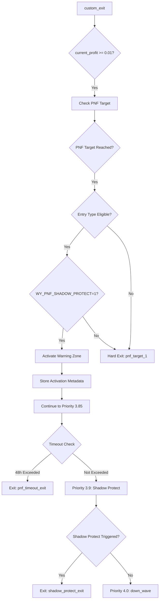
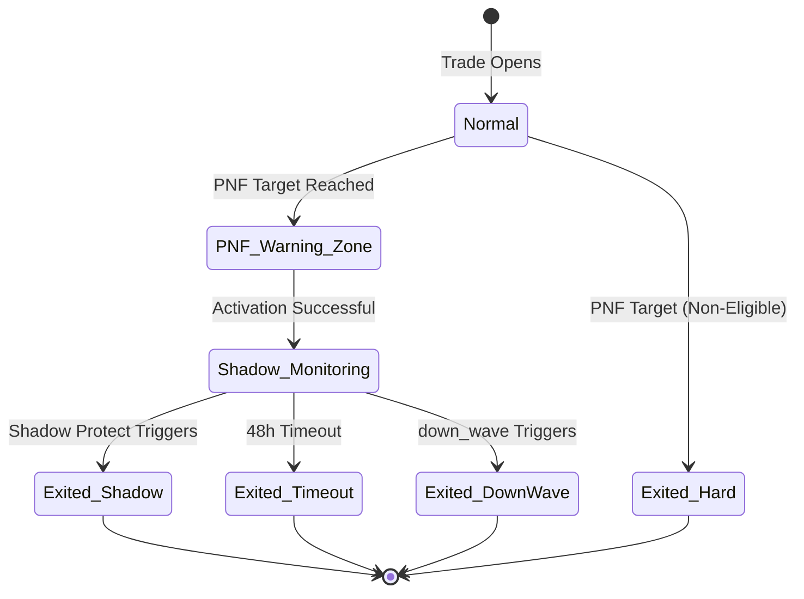

# Design Document: PNF Shadow Protect Integration

## Overview

This feature transforms the PNF (Point & Figure) target exit mechanism from a "hard exit line" into a "warning zone" that activates profit protection. When price reaches the PNF target, instead of immediately exiting the trade, the system activates Shadow Protect monitoring with adjusted thresholds to capture additional profit while protecting against givebacks.

### Problem Statement

Currently, when price reaches the PNF target (priority 3.8), the strategy immediately returns `pnf_target_1` or `pnf_target_2`, forcing an exit. This prevents capturing additional profit when momentum continues beyond the target. The A/B test data shows that `profit_protect_exit` (which includes Shadow Protect logic) had negative impact on axis_support trades, suggesting the original thresholds (6%/2.5%/3%) were too aggressive for early-stage exits.

### Solution Approach

Transform PNF target into a warning zone that:
1. **Activates Shadow Protect** with relaxed thresholds (4%/2%/2%) when PNF target is reached
2. **Reorders exit priority** to evaluate Shadow Protect before down_wave after PNF activation
3. **Implements 48h timeout** to prevent indefinite holds
4. **Maintains backward compatibility** for non-eligible entry types

### Key Design Decisions

**Decision 1: State Storage Pattern**
- **Choice**: Extend existing `_pnf_trades_metadata` dict to store PNF warning zone activation state
- **Rationale**: Reuses proven metadata pattern; avoids creating new storage mechanism
- **Alternative Rejected**: Create separate `_pnf_warning_zone_metadata` dict (unnecessary complexity)

**Decision 2: Exit Priority Implementation**
- **Choice**: Conditional branching within existing priority structure
- **Rationale**: Minimal code changes; maintains sequential if-elif pattern
- **Alternative Rejected**: Refactor to priority queue system (too invasive for this feature)

**Decision 3: Shadow Protect Dual-Mode**
- **Choice**: Single function with mode parameter based on PNF activation flag
- **Rationale**: Avoids code duplication; clear separation of concerns
- **Alternative Rejected**: Split into two functions (increases maintenance burden)

**Decision 4: Timeout Mechanism**
- **Choice**: Check timeout at priority 3.85 (between PNF and down_wave)
- **Rationale**: Allows timeout to override down_wave but not higher-priority exits
- **Alternative Rejected**: Integrate into PNF logic (violates single responsibility)

**Decision 5: Environment Variable**
- **Choice**: Check `WY_PNF_SHADOW_PROTECT` once at initialization, store in instance variable
- **Rationale**: Performance optimization; consistent behavior across trade lifecycle
- **Alternative Rejected**: Check per-trade (unnecessary overhead)

## Architecture

### Component Interaction



### State Machine



## Components and Interfaces

### 1. PNF Warning Zone Activation

**Location**: `_custom_exit_impl`, priority 3.8

**Interface**:
```python
def _check_pnf_warning_zone_activation(
    self,
    pair: str,
    trade: 'Trade',
    current_rate: float,
    current_profit: float,
    pnf_metadata: dict
) -> bool:
    """
    Check if PNF target is reached and activate warning zone if eligible.
    
    Args:
        pair: Trading pair
        trade: Freqtrade Trade object
        current_rate: Current price
        current_profit: Current profit ratio
        pnf_metadata: PNF metadata from _pnf_trades_metadata
        
    Returns:
        True if warning zone activated, False if hard exit should occur
    """
```

**Behavior**:
- Check if `WY_PNF_SHADOW_PROTECT` is enabled (instance variable)
- Check if entry_tag is eligible (`wyckoff_axis_support` or `wyckoff_sos_entry`)
- Check if PNF target is reached (long: `current_rate >= target_conservative`, short: `current_rate <= target_short_conservative`)
- If all conditions met:
  - Store activation metadata in `_pnf_trades_metadata[metadata_key]`
  - Log activation event
  - Return `True` (continue to next priority)
- Otherwise:
  - Return `False` (trigger hard exit)

**Metadata Stored**:
```python
{
    'pnf_warning_zone_activated': True,
    'pnf_activation_timestamp': current_time,
    'pnf_activation_profit': current_profit,
    'pnf_activation_price': current_rate,
    'pnf_target_reached': 'conservative' | 'standard',
}
```

### 2. Timeout Check

**Location**: `_custom_exit_impl`, priority 3.85

**Interface**:
```python
def _check_pnf_timeout(
    self,
    pair: str,
    trade: 'Trade',
    current_time: datetime,
    current_profit: float,
    pnf_metadata: dict
) -> Optional[str]:
    """
    Check if 48h timeout has been exceeded after PNF warning zone activation.
    
    Args:
        pair: Trading pair
        trade: Freqtrade Trade object
        current_time: Current timestamp
        current_profit: Current profit ratio
        pnf_metadata: PNF metadata from _pnf_trades_metadata
        
    Returns:
        'pnf_timeout_exit' if timeout exceeded, None otherwise
    """
```

**Behavior**:
- Check if `pnf_warning_zone_activated` is True
- Calculate elapsed time since `pnf_activation_timestamp`
- If elapsed time >= 48 hours:
  - Calculate max_profit_after_pnf
  - Log timeout exit with metrics
  - Return `'pnf_timeout_exit'`
- Otherwise:
  - Return `None` (continue to next priority)

### 3. Shadow Protect (PNF Mode)

**Location**: `_custom_exit_impl`, priority 3.9

**Interface**:
```python
def _check_shadow_protect_pnf_mode(
    self,
    pair: str,
    trade: 'Trade',
    current_profit: float,
    pnf_metadata: dict
) -> Optional[str]:
    """
    Check Shadow Protect conditions with PNF-activated thresholds.
    
    Args:
        pair: Trading pair
        trade: Freqtrade Trade object
        current_profit: Current profit ratio
        pnf_metadata: PNF metadata from _pnf_trades_metadata
        
    Returns:
        'shadow_protect_exit' if triggered, None otherwise
    """
```

**Behavior**:
- Check if `pnf_warning_zone_activated` is True
- Get max_profit from trade object (`trade.max_rate`)
- Calculate max_profit_ratio and giveback
- Apply PNF-mode thresholds:
  - `max_profit >= 0.04` (4%)
  - `giveback >= 0.02` (2%)
  - `current_profit >= 0.02` (2%)
- If all conditions met:
  - Update metadata with max_profit_after_pnf
  - Log Shadow Protect exit with metrics
  - Return `'shadow_protect_exit'`
- Otherwise:
  - Return `None` (continue to next priority)

### 4. Modified Shadow Protect Metadata Builder

**Location**: `_build_axis_shadow_profit_protect_metadata`

**Modified Interface**:
```python
def _build_axis_shadow_profit_protect_metadata(
    self,
    trade: 'Trade',
    current_profit: float,
    max_profit_seen: Optional[float],
    pnf_mode: bool = False  # NEW PARAMETER
) -> dict:
    """
    Shadow-only axis profit protection forensic fields.
    
    Args:
        trade: Freqtrade Trade object
        current_profit: Current profit ratio
        max_profit_seen: Maximum profit achieved
        pnf_mode: If True, use PNF-activated thresholds (4%/2%/2%)
                  If False, use original thresholds (6%/2.5%/3%)
    
    Returns:
        dict: Metadata with shadow protect forensic fields
    """
```

**Behavior**:
- If `pnf_mode=True`:
  - Use thresholds: `activation_profit=0.04`, `giveback_threshold=0.02`, `min_current_profit=0.02`
  - Add `'shadow_protect_mode': 'pnf'` to metadata
- If `pnf_mode=False`:
  - Use original thresholds: `activation_profit=0.06`, `giveback_threshold=0.025`, `min_current_profit=0.03`
  - Add `'shadow_protect_mode': 'original'` to metadata
- Calculate and return metadata dict

## Data Models

### Extended PNF Metadata Structure

```python
# Stored in self._pnf_trades_metadata[(pair, open_date_str)]
{
    # Existing fields (from pnf-target-bug-fix)
    'target_conservative': float,      # Conservative PNF target price
    'target_standard': float,          # Standard PNF target price
    'target_short_conservative': float,  # Short conservative target
    'target_short_standard': float,    # Short standard target
    
    # NEW fields for PNF Shadow Protect
    'pnf_warning_zone_activated': bool,  # True if PNF target reached and warning zone activated
    'pnf_activation_timestamp': datetime,  # When warning zone was activated
    'pnf_activation_profit': float,    # Profit ratio at activation time
    'pnf_activation_price': float,     # Price at activation time
    'pnf_target_reached': str,         # 'conservative' or 'standard'
    'max_profit_after_pnf': float,     # Maximum profit achieved after PNF activation
    'shadow_protect_pnf_mode': bool,   # True if Shadow Protect used PNF thresholds
}
```

### Instance Variables

```python
class WyckoffV7_TrueMethod(IStrategy):
    # Existing
    _pnf_trades_metadata: Dict[tuple, Dict] = {}  # (pair, open_date_str) -> metadata
    
    # NEW
    pnf_shadow_protect_enabled: bool  # Cached value of WY_PNF_SHADOW_PROTECT
    pnf_timeout_hours: float = 48.0   # Configurable timeout duration
```

## Error Handling

### Error Scenarios

1. **Missing PNF Metadata**
   - **Scenario**: `_pnf_trades_metadata.get(metadata_key)` returns empty dict
   - **Handling**: Skip PNF warning zone logic; fall through to down_wave
   - **Logging**: DEBUG level - "PNF metadata not found for {pair}"

2. **Invalid Activation Timestamp**
   - **Scenario**: `pnf_activation_timestamp` is None or invalid
   - **Handling**: Skip timeout check; continue to Shadow Protect
   - **Logging**: WARNING level - "Invalid PNF activation timestamp for {pair}"

3. **Max Profit Calculation Failure**
   - **Scenario**: `trade.max_rate` is None or invalid
   - **Handling**: Skip Shadow Protect check; continue to down_wave
   - **Logging**: WARNING level - "Cannot calculate max_profit for {pair}"

4. **Environment Variable Parse Error**
   - **Scenario**: `WY_PNF_SHADOW_PROTECT` has unexpected value
   - **Handling**: Default to enabled (`'1'`)
   - **Logging**: WARNING level - "Invalid WY_PNF_SHADOW_PROTECT value, defaulting to enabled"

### Exception Handling Pattern

```python
try:
    # PNF warning zone logic
    if self._check_pnf_warning_zone_activation(...):
        return None  # Continue to next priority
    else:
        return 'pnf_target_1'  # Hard exit
except Exception as e:
    logger.warning(f'PNF warning zone check failed for {pair}: {e}')
    return 'pnf_target_1'  # Fail-safe: hard exit
```

## Testing Strategy

### Property-Based Testing Assessment

**PBT is NOT appropriate for this feature** because:

1. **Not a pure function**: The feature involves side effects (trade exits, logging, metadata mutation)
2. **State machine logic**: Testing requires specific state transitions, not universal properties
3. **Configuration validation**: The correctness is about business rules (thresholds, priorities), not mathematical properties
4. **Framework integration**: Requires mocking Freqtrade Trade objects and framework behavior

**Appropriate testing approach**:
- **Unit tests**: Test each helper method with concrete example scenarios
- **Integration tests**: Test full trade lifecycle with mock trades
- **Backtest validation**: Validate behavior with historical data (A/B testing)

### Unit Tests

**Test Suite**: `test_pnf_shadow_protect.py`

**Test Coverage**: Each test validates specific acceptance criteria from requirements document.

1. **Test PNF Warning Zone Activation** (Validates: Requirements 1.1-1.5, 3.1-3.5)
   - Example: Eligible entry type (`wyckoff_axis_support`) with PNF target reached → activates warning zone
   - Example: Non-eligible entry type (`wyckoff_spring`) with PNF target reached → hard exit
   - Example: WY_PNF_SHADOW_PROTECT=0 with eligible entry → hard exit
   - Example: Metadata correctly stored with activation timestamp, profit, price
   - Edge case: PNF target = 0.0 → skip PNF logic entirely

2. **Test Timeout Mechanism** (Validates: Requirements 5.1-5.5)
   - Example: Warning zone activated 49h ago → timeout triggers
   - Example: Warning zone activated 47h ago → timeout does not trigger
   - Example: Warning zone not activated → timeout check skipped
   - Example: Timeout exit includes correct metadata (activation_profit, max_profit_after_pnf)
   - Edge case: Invalid activation timestamp → skip timeout check

3. **Test Shadow Protect PNF Mode** (Validates: Requirements 2.1-2.6)
   - Example: PNF mode with max_profit=5%, giveback=2.5%, current=2.5% → triggers
   - Example: PNF mode with max_profit=3%, giveback=2.5%, current=2.5% → does not trigger (max too low)
   - Example: Original mode with max_profit=5%, giveback=2.5%, current=2.5% → does not trigger (wrong thresholds)
   - Example: Warning zone not activated → Shadow Protect check skipped
   - Edge case: trade.max_rate is None → skip Shadow Protect check

4. **Test Exit Priority Ordering** (Validates: Requirements 4.1-4.5)
   - Example: PNF not activated → down_wave executes at priority 4.0
   - Example: PNF activated, Shadow Protect triggers → down_wave skipped
   - Example: PNF activated, timeout triggers → Shadow Protect and down_wave skipped
   - Example: stop_loss triggers → all PNF logic skipped (higher priority)
   - Example: PNF activated, Shadow Protect not triggered → down_wave evaluates

5. **Test Backward Compatibility** (Validates: Requirements 10.1-10.5)
   - Example: Non-eligible entry type → maintains hard exit behavior
   - Example: PNF target = 0.0 → skips PNF logic entirely
   - Example: WY_PROFIT_PROTECT=1 explicitly set → honored regardless of PNF activation
   - Example: Existing metadata fields preserved after PNF activation
   - Example: Non-PNF-activated trade → all existing exit priorities unchanged

6. **Test Metadata and Forensics** (Validates: Requirements 7.1-7.8)
   - Example: Warning zone activation stores all required fields
   - Example: Timeout exit includes max_profit_after_pnf
   - Example: Shadow Protect exit includes shadow_protect_pnf_mode flag
   - Example: Metadata survives across multiple custom_exit calls
   - Example: Exit reason detail explains which mechanism triggered

### Integration Tests

**Test Suite**: `test_pnf_shadow_protect_integration.py`

**Test Coverage**: End-to-end scenarios validating complete trade lifecycles.

1. **Test Full Trade Lifecycle Scenarios**
   - Scenario 1: Trade opens → PNF target reached → warning zone activated → Shadow Protect triggers
     - Validate: Metadata stored, Shadow Protect uses PNF thresholds, exit reason correct
   - Scenario 2: Trade opens → PNF target reached → warning zone activated → 48h timeout triggers
     - Validate: Timeout calculated correctly, max_profit_after_pnf recorded, exit reason correct
   - Scenario 3: Trade opens → PNF target reached → warning zone activated → down_wave triggers
     - Validate: Shadow Protect evaluated first, down_wave executes when Shadow Protect not triggered
   - Scenario 4: Trade opens → PNF target reached → non-eligible entry → hard exit
     - Validate: Warning zone not activated, immediate exit with pnf_target_1

2. **Test Metadata Persistence**
   - Test: Metadata survives across multiple custom_exit calls (simulating multiple candles)
   - Test: Metadata correctly retrieved in backtest mode (from instance variable)
   - Test: Metadata correctly retrieved in live/dry-run mode (from Trade.custom_info)
   - Test: Metadata key format `(pair, open_date_str)` works correctly

3. **Test A/B Test Compatibility**
   - Test: WY_PNF_SHADOW_PROTECT=0 produces identical exit behavior to baseline
   - Test: WY_PNF_SHADOW_PROTECT=1 activates new warning zone behavior
   - Test: Environment variable checked at initialization, not per-trade
   - Test: Logging includes WY_PNF_SHADOW_PROTECT setting at startup

4. **Test Interaction with Profit Protect Exit** (Validates: Requirements 6.1-6.5)
   - Test: Profit_Protect_Exit evaluates after Shadow Protect when PNF activated
   - Test: Profit_Protect_Exit can trigger if Shadow Protect conditions not met
   - Test: WY_PROFIT_PROTECT=0 default maintained for non-PNF-activated trades
   - Test: WY_PROFIT_PROTECT=1 explicitly set works regardless of PNF activation

### Backtest Validation

**Test Period**: 2022-01-01 to 2026-05-02

**Validation Criteria**:
1. All PNF-activated trades have `pnf_warning_zone_activated=True` in metadata
2. No trades exit with `pnf_target_1` when WY_PNF_SHADOW_PROTECT=1 and entry_tag is eligible
3. Timeout rate < 10% of PNF-activated trades
4. Average profit per trade increases for PNF-activated exits vs baseline
5. Giveback after PNF target is reduced vs baseline

**Backtest Commands**:
```bash
# Baseline (hard exit)
docker compose run --rm freqtrade backtesting \
  --config user_data/config_backtest.json \
  --strategy WyckoffV7_TrueMethod \
  --timerange 20220101-20260502 \
  --cache none \
  -e WY_PNF_SHADOW_PROTECT=0

# New behavior (warning zone)
docker compose run --rm freqtrade backtesting \
  --config user_data/config_backtest.json \
  --strategy WyckoffV7_TrueMethod \
  --timerange 20220101-20260502 \
  --cache none \
  -e WY_PNF_SHADOW_PROTECT=1
```

**Validation Script**: `analyze_pnf_shadow_protect.py`

```python
# Analyze backtest results to validate success metrics
# 1. Parse backtest JSON output
# 2. Filter trades with PNF activation
# 3. Calculate metrics:
#    - Timeout rate
#    - Average profit improvement
#    - Giveback reduction
#    - Exit quality score
# 4. Generate comparison report
```

## Implementation Notes

### Code Locations

**File**: `user_data/strategies/WyckoffV7_TrueMethod.py`

**Modifications**:

1. **`__init__` method** (~line 700)
   - Add `self.pnf_shadow_protect_enabled` instance variable
   - Initialize from `WY_PNF_SHADOW_PROTECT` environment variable
   - Log the setting at INFO level

2. **`_custom_exit_impl` method** (~line 5270)
   - **Priority 3.8**: Replace hard exit with `_check_pnf_warning_zone_activation` call
   - **Priority 3.85**: Add `_check_pnf_timeout` call (NEW)
   - **Priority 3.9**: Add `_check_shadow_protect_pnf_mode` call (NEW)
   - **Priority 4.0**: down_wave logic remains unchanged

3. **New helper methods** (add after `_build_axis_shadow_profit_protect_metadata`)
   - `_check_pnf_warning_zone_activation`
   - `_check_pnf_timeout`
   - `_check_shadow_protect_pnf_mode`

4. **`_build_axis_shadow_profit_protect_metadata` method** (~line 5072)
   - Add `pnf_mode` parameter (default `False`)
   - Conditional threshold selection based on `pnf_mode`
   - Add `'shadow_protect_mode'` to returned metadata

### Performance Considerations

1. **Metadata Lookup Overhead**
   - `_pnf_trades_metadata.get()` is O(1) dict lookup
   - Negligible performance impact (< 1μs per call)

2. **Timestamp Calculation**
   - `(current_time - activation_timestamp).total_seconds()` is fast
   - Only executed when warning zone is activated (rare)

3. **Exit Priority Checks**
   - Added 2 new priority checks (3.85, 3.9)
   - Each check is guarded by activation flag (early return if not activated)
   - Minimal impact on non-PNF-activated trades

### Logging Strategy

**Log Levels**:
- **INFO**: Activation events, exit events, timeout events
- **DEBUG**: Evaluation checks that don't trigger exits, metadata lookups
- **WARNING**: Error conditions, missing metadata, invalid timestamps

**Log Format Examples**:

```python
# Initialization (INFO)
logger.info(f'PNF Shadow Protect: {"启用" if self.pnf_shadow_protect_enabled else "禁用"} '
            f'(WY_PNF_SHADOW_PROTECT={os.getenv("WY_PNF_SHADOW_PROTECT", "1")})')

# Activation (INFO) - Validates Requirement 9.1
logger.info(f'PNF 警告区激活: {pair}, target={target:.2f}, current={current_rate:.2f}, '
            f'profit={current_profit:.2%}, entry_tag={trade.enter_tag}')

# Shadow Protect Evaluation (DEBUG) - Validates Requirement 9.2
logger.debug(f'Shadow Protect 评估 (PNF模式): {pair}, '
             f'max_profit={max_profit:.2%}, giveback={giveback:.2%}, '
             f'current_profit={current_profit:.2%}, 阈值=4%/2%/2%')

# Shadow Protect Trigger (INFO) - Validates Requirement 9.3
logger.info(f'Shadow Protect 退出 (PNF模式): {pair}, '
            f'max_profit={max_profit:.2%}, giveback={giveback:.2%}, '
            f'current_profit={current_profit:.2%}, 阈值=4%/2%/2%')

# Timeout (INFO) - Validates Requirement 9.4
logger.info(f'PNF 超时退出: {pair}, 持仓={hold_hours:.1f}h, '
            f'激活利润={activation_profit:.2%}, 当前利润={current_profit:.2%}, '
            f'最高利润={max_profit_after_pnf:.2%}')

# Profit Protect after PNF (INFO) - Validates Requirement 9.5
logger.info(f'浮盈弱势退出 (PNF激活后): {pair}, 持仓={hold_h:.1f}h, '
            f'收益={current_profit:.2%}, 量缩({vol:.0f}<{vol_sma*0.7:.0f})+阴线')

# Hard Exit (INFO) - Non-eligible or disabled
logger.info(f'P&F 目标位1(多头保守): {pair}, '
            f'current={current_rate:.2f} >= target_cons={target_cons:.2f}, '
            f'收益={current_profit:.2%} [硬退出: 不符合条件或功能禁用]')

# Error Handling (WARNING)
logger.warning(f'PNF 警告区检查失败: {pair}, 错误={str(e)}, 回退到硬退出')
```

**Logging Requirements** (Validates Requirements 9.1-9.7):
1. ✅ Activation logs include: pair, current_rate, target, current_profit, entry_tag
2. ✅ Evaluation logs include: max_profit, giveback, current_profit, thresholds
3. ✅ Trigger logs include: all condition values and profit metrics
4. ✅ Timeout logs include: hold duration, max_profit, current_profit
5. ✅ Profit_Protect logs include: volume metrics and profit
6. ✅ INFO level for activation and exit events
7. ✅ DEBUG level for evaluation checks that don't trigger exits

### Observability and Monitoring

**Key Metrics to Track** (for P5 Intelligence Layer integration):

```python
# Event emission for P5 (future integration)
if self.event_bridge is not None:
    self.event_bridge.emit_custom_event(
        event_type='pnf_warning_zone_activated',
        pair=pair,
        trade_id=str(trade.id),
        data={
            'target_price': target,
            'activation_price': current_rate,
            'activation_profit': current_profit,
            'entry_tag': trade.enter_tag,
        }
    )
```

**Dashboard Indicators**:
- PNF activation rate (% of trades reaching PNF target)
- Shadow Protect trigger rate (% of PNF-activated trades)
- Timeout trigger rate (% of PNF-activated trades)
- down_wave trigger rate after PNF activation
- Average hold time after PNF activation
- Average profit improvement vs hard exit baseline
- Giveback reduction vs hard exit baseline

### Performance Considerations

- [ ] Non-eligible entry types maintain hard exit behavior
- [ ] WY_PNF_SHADOW_PROTECT=0 produces identical results to baseline
- [ ] Invalid PNF targets (0.0) skip PNF logic entirely
- [ ] WY_PROFIT_PROTECT=1 is honored regardless of PNF activation
- [ ] All existing metadata fields are preserved
- [ ] Existing exit priorities are unchanged for non-PNF-activated trades

### Deployment Strategy

**Phase 1: Development**
- Implement core logic with unit tests
- Validate with sample trades in test environment

**Phase 2: Backtest Validation**
- Run full backtest (2022-2026) with WY_PNF_SHADOW_PROTECT=0 (baseline)
- Run full backtest (2022-2026) with WY_PNF_SHADOW_PROTECT=1 (new behavior)
- Compare metrics: profit per trade, timeout rate, giveback reduction

**Phase 3: Dry-Run Testing**
- Deploy to dry-run environment with WY_PNF_SHADOW_PROTECT=1
- Monitor for 1 week (minimum 10 trades)
- Validate metadata persistence and exit behavior

**Phase 4: Production Rollout**
- Deploy to production with WY_PNF_SHADOW_PROTECT=1 (default enabled)
- Monitor for 2 weeks
- Collect A/B test data for final validation

## Related Specifications

- **`.kiro/specs/pnf-target-bug-fix.md`**: Fixed PNF target calculation bug (prerequisite)
- **`docs/P5-Data-Design.md`**: Event emission for P5 intelligence layer (future integration)

## Success Metrics

### Primary Metrics

1. **Profit Capture Rate**
   - **Baseline**: Average profit at PNF hard exit
   - **Target**: +15% increase in average profit for PNF-activated exits
   - **Measurement**: Compare `current_profit` at exit time

2. **Giveback Reduction**
   - **Baseline**: Average giveback after PNF target reached (hard exit)
   - **Target**: -30% reduction in average giveback
   - **Measurement**: Track `max_profit_after_pnf - exit_profit`

3. **Timeout Rate**
   - **Target**: < 10% of PNF-activated trades hit 48h timeout
   - **Measurement**: Count `pnf_timeout_exit` / total PNF activations

### Secondary Metrics

4. **Exit Quality Score**
   - **Definition**: Percentage of exits that occur within 5% of max_profit_after_pnf
   - **Target**: > 70% of Shadow Protect exits are "high quality"
   - **Measurement**: Track `(max_profit - exit_profit) / max_profit < 0.05`

5. **Comparative Performance**
   - **Baseline**: Backtest with WY_PNF_SHADOW_PROTECT=0
   - **Target**: Total return improvement > 5%
   - **Measurement**: Compare final portfolio value

### Monitoring Dashboard

**Key Indicators**:
- PNF activation rate (% of trades)
- Shadow Protect trigger rate (% of PNF-activated trades)
- Timeout trigger rate (% of PNF-activated trades)
- down_wave trigger rate after PNF activation (% of PNF-activated trades)
- Average hold time after PNF activation
- Average profit improvement vs hard exit

## Appendix: Exit Priority Reference

### Current Priority Order (Baseline)

```
1.0  stop_loss (Freqtrade framework)
2.0  trailing_stop (Freqtrade framework)
3.0  wyckoff_climax_exit
3.1  severe_divergence_exit
3.2  sot_exit
3.5  sow_fast_exit
3.6  profit_protect_exit (WY_PROFIT_PROTECT=1)
3.7  ~~axis_support_failed_exit (WY_AXIS_FAILED_EXIT=1)~~ [已归档 2026-05-03]
     理由: 3.25年仅4笔触发，样本不足，已有 timeout_loss_exit 兜底
3.75 timeout_loss_exit
3.8  pnf_target_1 / pnf_target_2 (HARD EXIT)
4.0  wyckoff_down_wave
5.0  ROI (Freqtrade framework)
```

### New Priority Order (WY_PNF_SHADOW_PROTECT=1)

```
1.0  stop_loss (Freqtrade framework)
2.0  trailing_stop (Freqtrade framework)
3.0  wyckoff_climax_exit
3.1  severe_divergence_exit
3.2  sot_exit
3.5  sow_fast_exit
3.6  profit_protect_exit (WY_PROFIT_PROTECT=1)
3.7  ~~axis_support_failed_exit (WY_AXIS_FAILED_EXIT=1)~~ [已归档 2026-05-03]
     理由: 3.25年仅4笔触发，样本不足，已有 timeout_loss_exit 兜底
3.75 timeout_loss_exit
3.8  pnf_warning_zone_activation (CONTINUE, not exit)
3.85 pnf_timeout_exit (NEW - 48h timeout)
3.9  shadow_protect_exit (NEW - PNF mode)
4.0  wyckoff_down_wave
5.0  ROI (Freqtrade framework)
```

### Priority Logic Flow

```python
# Priority 3.8: PNF Target Check
if current_profit >= 0.01:
    metadata_key = (pair, str(trade.open_date_utc))
    pnf_metadata = self._pnf_trades_metadata.get(metadata_key, {})
    
    if not trade.is_short:
        _tgt_cons = float(pnf_metadata.get('target_conservative', 0.0) or 0.0)
        if _tgt_cons > 0 and current_rate >= _tgt_cons:
            # NEW: Check if warning zone should activate
            if self._check_pnf_warning_zone_activation(pair, trade, current_rate, current_profit, pnf_metadata):
                # Warning zone activated, continue to next priority
                pass
            else:
                # Hard exit (non-eligible or disabled)
                logger.info(f'P&F 目标位1(多头保守): {pair}, ...')
                return 'pnf_target_1'

# Priority 3.85: PNF Timeout Check (NEW)
if pnf_metadata.get('pnf_warning_zone_activated'):
    timeout_exit = self._check_pnf_timeout(pair, trade, current_time, current_profit, pnf_metadata)
    if timeout_exit:
        return timeout_exit

# Priority 3.9: Shadow Protect PNF Mode (NEW)
if pnf_metadata.get('pnf_warning_zone_activated'):
    shadow_exit = self._check_shadow_protect_pnf_mode(pair, trade, current_profit, pnf_metadata)
    if shadow_exit:
        return shadow_exit

# Priority 4.0: down_wave (unchanged)
# ... existing down_wave logic ...
```
